# تصميم قاعدة البيانات: ERD مفاهيمي، Multi-Tenancy، RBAC وRLS

- **الحالة:** تصميم مقترح للمرحلة 1، لا schema أو migration معتمد.
- **الأساس الذي أمكن التحقق منه:** commit `57790b25edb9fe8f37c47eada4f03312bbf43af1` يحوي `AGENTS.md`, `README.md`, و`project-docs` الفارغ. لم يوجد تقرير مرحلة 0 محفوظ؛ أُنشئ تقرير توثيقي بأثر رجعي في `docs/audit/phase-0-read-only-audit.md` اعتماداً على هذه الشجرة.
- **NOT VERIFIED:** لا يوجد تطبيق أو DB أو migrations أو اختبارات. لم تُراجع الوثائق الرسمية الحالية لـ Supabase/Auth/Data API/RLS/Realtime/Storage؛ كل التوصيات هنا تصميمية.

## ERD المقترح

```mermaid
erDiagram
  AUTH_USERS ||--o{ MEMBERSHIPS : joins
  ORGANIZATIONS ||--o{ MEMBERSHIPS : contains
  ORGANIZATIONS ||--o{ PROJECTS : owns
  PROJECTS ||--o| BUSINESS_PROFILES : describes
  ORGANIZATIONS ||--o{ BUSINESS_FACTS : records
  ORGANIZATIONS ||--o{ CONVERSATIONS : owns
  CONVERSATIONS ||--o{ MESSAGES : contains
  ORGANIZATIONS ||--o{ TASKS : tracks
  ORGANIZATIONS ||--o{ CONTENT_PLANS : owns
  CONTENT_PLANS ||--|{ CONTENT_ITEMS : contains
  ORGANIZATIONS ||--o{ PLANS : offers
  PLANS ||--o{ SUBSCRIPTIONS : selected
  ORGANIZATIONS ||--o{ SUBSCRIPTIONS : subscribes
  ORGANIZATIONS ||--o{ ORG_BUDGETS : limits
  ORGANIZATIONS ||--o{ ORG_QUOTAS : limits
  ORGANIZATIONS ||--o{ USAGE_EVENTS : meters
  ORGANIZATIONS ||--o{ INVITATIONS : invites
  ORGANIZATIONS ||--o{ INTEGRATIONS : connects
  ORGANIZATIONS ||--o{ ACTIONS : requests
  ACTIONS ||--|{ ACTION_VERSIONS : versions
  ACTION_VERSIONS ||--o{ APPROVALS : approved_by
  ORGANIZATIONS ||--o{ AUDIT_EVENTS : audits
  ORGANIZATIONS ||--o{ IMPERSONATION_SESSIONS : scopes
  IMPERSONATION_SESSIONS ||--|{ IMPERSONATION_APPROVALS : authorized_by
  PLATFORM_ADMINS ||--o{ IMPERSONATION_SESSIONS : initiates
  MEMBERSHIPS ||--o{ MEMBERSHIP_ROLE_ASSIGNMENTS : grants
  RBAC_ROLES ||--o{ MEMBERSHIP_ROLE_ASSIGNMENTS : assigns
  RBAC_ROLES ||--o{ ROLE_PERMISSIONS : maps
  RBAC_PERMISSIONS ||--o{ ROLE_PERMISSIONS : grants
```

## قواعد FK المركب الإلزامية

- كل parent table الذي يشارك في علاقة tenant يعرّف `UNIQUE (org_id, id)` بالإضافة إلى primary key على `id`.
- كل child table tenant تابع يملك `org_id NOT NULL`، ولكل parent علاقةً به، FK إلزامي `(org_id, parent_id) REFERENCES parent(org_id, id)`. في حالة عدة parents (مثلاً message→conversation أو approvals→action_version) تُفرض علاقة مركبة لكل parent. لا توجد علاقة parent-child عابرة لـ org.
- `organizations` هو جذر tenant و`org_id` فيه مفتاحه الأساسي؛ العضوية تربط `org_id` بالمؤسسة و`user_id` بهوية `auth.users`. الجداول العالمية غير التابعة لمؤسسة موضحة صراحة أدناه.
- قيود uniqueness متعددة المستأجرين تبدأ بـ `org_id`، مثل `UNIQUE (org_id, id)` و`UNIQUE (org_id, user_id)` أو `UNIQUE (org_id, normalized_name)` حسب الحاجة. أسماء الفهارس/أنواع البيانات قرار تنفيذ لاحق.

## الجداول والعلاقات والبيانات الأساسية

| الجدول | العلاقات/الحقول المفاهيمية | التصنيف والقيود |
|---|---|---|
| `organizations` | `id`, name, status, timestamps | tenant root؛ `UNIQUE (org_id,id)` لا ينطبق كجدول parent root، و`id` PK |
| `memberships` | `(org_id,user_id)`, status, joined_at | tenant child: org FK؛ unique `(org_id,user_id)`؛ إلى Auth user |
| `rbac_roles` | id, org_id?, key, scope | system role catalog قد يكون global؛ org-custom role tenant child؛ فصل النوعين مطلوب بالـ schema |
| `rbac_permissions` | key, resource, action | global catalog؛ لا tenant write |
| `membership_role_assignments` | org_id, membership_id, role_id, granted_by | FK مركب إلى membership والـ org role؛ global system role بديل محدد منفصل |
| `role_permissions` | role_id, permission_key | catalog mapping؛ global configuration يديره migration/admin، لا tenant client |
| `projects` | id, org_id, name, status | tenant child؛ `UNIQUE(org_id,id)` |
| `business_profiles` | id, org_id, project_id, business attributes, locale/voice, updated_by | tenant child؛ FK مركب إلى project؛ profile واحدة للمشروع حسب قيد مقترح |
| `business_facts` | id, org_id, project_id?, fact, provenance, source, added_by, verified_at | tenant child؛ FK مركب إلى project عند وجوده؛ provenance إلزامي للحقائق |
| `conversations` | id, org_id, project_id?, created_by, timestamps | tenant child؛ FK مركب إلى project إن وجد |
| `messages` | id, org_id, conversation_id, role, content, created_at | tenant child؛ FK مركب إلزامي إلى conversation؛ تخزين محتوى/PII وسياسة حذفه مفتوحة |
| `tasks` | id, org_id, conversation_id?, status, correlation_id, created_by | tenant child؛ FK مركب إلى conversation إن وجد |
| `content_plans` | id, org_id, project_id, status, created_by, version | tenant child؛ FK مركب إلى project |
| `content_items` | id, org_id, plan_id, body, claims/provenance, version | tenant child؛ FK مركب إلى content_plan |
| `plans` | id, code, name, feature/limit definition, active | SaaS catalog global، ليست tenant-owned؛ أسلوب تعديل catalog غير محسوم |
| `subscriptions` | id, org_id, plan_id, status, period, external_ref | tenant child؛ FK مركب إلى org؛ FK إلى global plan؛ payment provider `NOT VERIFIED` |
| `org_budgets` | id, org_id, period, limit, consumed/reserved values | tenant child؛ UNIQUE `(org_id, period)` المقترح؛ reservation/settlement موضح في gateway design |
| `org_quotas` | id, org_id, quota_key, limit, period | tenant child؛ UNIQUE `(org_id, quota_key, period)` المقترح |
| `usage_events` | id, org_id, task_id?, skill, provider/model, token counts, estimated_cost, latency, outcome | tenant child، append-only؛ FK مركب إلى task عند ربطه |
| `invitations` | id, org_id, invitee identifier, role, token_digest, expires_at, status, invited_by | tenant child؛ لا تخزن invitation secret plaintext؛ expiry/revocation |
| `integrations` | id, org_id, provider_key, scopes, secret_ref, status | tenant child؛ لا تخزن OAuth secret plaintext؛ secret manager قرار مفتوح |
| `actions` | id, org_id, requester, action_type, risk_level, state, current_version, idempotency scope | tenant child؛ parent aggregate للإصدارات؛ لا payload mutable داخل action |
| `action_versions` | id, org_id, action_id, version_no, immutable payload_snapshot, payload_hash, scheduled_time, target_account_id, created_at | tenant child؛ FK مركب action؛ UNIQUE `(org_id,action_id,version_no)`؛ hash يغطي canonical payload و`scheduled_time` وtarget account identifier؛ immutable بعد الإدراج |
| `approvals` | id, org_id, action_id, action_version_id, approver, approval_kind, decision, approved_hash, decided_at, expires_at | tenant child؛ FK مركب إلى action وaction_version مع قيد يضمن اتساقهما؛ عدة سجلات لكل action/version لدعم إعادة الموافقة وL3 confirmation |
| `audit_events` | id, org_id?, actor, source, event, correlation_id, redacted before/after, created_at | tenant event أو system event بضوابط؛ append-only بلا UPDATE/DELETE |
| `platform_admins` | id, auth_user_id, platform_role, status, MFA/identity metadata | منصة global لا tenant؛ منفصل عن customer RBAC، أقوى مصادقة وAudit |
| `impersonation_sessions` | id, org_id, platform_admin_id, reason, state, start/end, correlation_id | tenant scoped session؛ FK مركب إلى org + FK إلى platform admin؛ لا تبدأ قبل موافقة العميل |
| `impersonation_approvals` | id, org_id, impersonation_session_id, client_approver_membership_id, decision, expires_at | tenant child؛ FK مركب إلى session وmembership؛ موافقة صريحة ووقتية؛ سجل القرار لا يُعدّل |

## Multi-Tenancy وRBAC

- المستخدم يمكن أن يملك memberships متعددة. اختيار `org_id` من العميل مدخل غير موثوق حتى يتحقق API من JWT وعضوية نشطة.
- الطلب: تحقق JWT → تحقق عضوية وصلاحية على المؤسسة → tenant context transaction → Service/Repository مع `org_id` صريح → RLS. لا DB credentials للمتصفح.
- أدوار المقترح: `owner`, `admin`, `marketing_manager`, `editor`, `approver`, `analyst`, `viewer`. الصلاحيات granular؛ approval permissions مستقلة عن التحرير. `platform_admins` معزول عن tenant roles.
- **موافقة صاحب الطلب على إجرائه — خيارات غير محسومة:** (أ) منع self-approval لكل L2/L3؛ فصل المهام أقوى لكنه قد يعطل فرقاً صغيرة. (ب) السماح لصاحب الطلب بالموافقة على L2 فقط بشروط/إثبات ثانٍ لـ L3؛ أقل احتكاكاً مع مخاطر تضارب المصالح. (ج) سياسة حسب المؤسسة/نوع الإجراء مع افتراضي أكثر تقييداً؛ مرنة لكنها تزيد التعقيد. يلزم قرار موثق في المرحلة 2، مع عدم تفعيل auto-approval L2/L3.

## مصفوفة RLS — كل جدول في ERD

تعريف: «ممنوع» يعني لا policy تسمح بعملية العميل. كل tenant policy تتحقق من tenant context/عضوية صالحة وتستخدم `WITH CHECK` للكتابة؛ الحالة الفعلية `NOT VERIFIED` حتى التنفيذ والاختبار.

| الجدول | SELECT | INSERT | UPDATE | DELETE |
|---|---|---|---|---|
| `organizations` | عضو نشط فقط | API onboarding موثق | owner/admin بصلاحية | ممنوع للعميل؛ lifecycle مُدار |
| `memberships` | الذات، وowner/admin حسب permission | owner/admin أو onboarding | owner/admin؛ لا إزالة آخر owner | تعطيل/soft delete بصلاحية؛ لا hard delete للعميل |
| `rbac_roles` | catalog أو أعضاء المؤسسة | owner/admin للأدوار المخصصة | owner/admin للأدوار المخصصة | ممنوع للأدوار الثابتة؛ المخصصة فقط بعد فحص الاستخدام |
| `rbac_permissions` | قراءة catalog عند الحاجة | ممنوع | ممنوع | ممنوع |
| `membership_role_assignments` | tenant members بصلاحية | owner/admin مع Audit | owner/admin مع Audit | owner/admin إلغاء assignment مع Audit |
| `role_permissions` | قراءة catalog | ممنوع على العميل | ممنوع | ممنوع |
| `projects` | عضو tenant | `project:create` | `project:edit` | soft-delete بصلاحية خاصة؛ hard delete ممنوع |
| `business_profiles` | عضو tenant | `profile:write` | `profile:write` | lifecycle policy؛ لا حذف بلا Audit |
| `business_facts` | عضو tenant | `facts:write` مع provenance/review | `facts:verify`/write | soft delete مع Audit |
| `conversations` | عضو tenant بصلاحية | API/عضو مخول | مالك/صلاحية edit | soft delete/retention policy |
| `messages` | عضو tenant + parent same org | API/agent مخول | append/version وفق policy؛ لا overwrite غير مدقق | ممنوع للحساب العادي؛ lifecycle |
| `tasks` | عضو tenant بصلاحية | API/worker موثق فقط | state machine/service فقط | ممنوع للعميل |
| `content_plans` | عضو tenant | `content:create` | `content:edit`; يبطل موافقة النسخة | soft delete/Audit |
| `content_items` | عضو tenant + parent same org | `content:edit` | `content:edit`; إصدار جديد يبطل approval | soft delete/Audit |
| `plans` | قراءة catalog | ممنوع على tenant | ممنوع على tenant | ممنوع على tenant |
| `subscriptions` | عضو billing:view | billing service فقط | billing service/state transitions | ممنوع للعميل؛ lifecycle provider |
| `org_budgets` | owner/admin أو usage:view | billing/usage service | usage service ذرياً وفق reservation | ممنوع للعميل |
| `org_quotas` | owner/admin أو usage:view | billing service فقط | billing service فقط | ممنوع للعميل |
| `usage_events` | member مع `usage:view` | Gateway/service فقط | ممنوع | ممنوع |
| `invitations` | owner/admin أو المدعو عبر token محدود | `membership:invite` | owner/admin إلغاء/تغيير صالح مع Audit | ممنوع؛ revoke state transition |
| `integrations` | `integration:view` مع إخفاء الأسرار | `integration:manage` عبر API | `integration:manage` عبر API | ممنوع hard delete؛ disconnect workflow |
| `actions` | عضو مع `action:view` | Action Gateway فقط | gateway state transitions فقط | ممنوع؛ cancel transition |
| `action_versions` | عضو مع action view | Action Gateway فقط | ممنوع (immutable) | ممنوع |
| `approvals` | عضو مع `approval:view` | Action Gateway pending request | قرار موافقة append-only؛ لا تعديل قرار سابق | ممنوع؛ إبطال/انتهاء event/state |
| `audit_events` | `audit:view` ضمن tenant؛ platform audit منفصل | audit writer فقط | ممنوع | ممنوع |
| `platform_admins` | لا وصول tenant؛ platform admin system role فقط | provisioning موثق | platform security admins فقط مع Audit | ممنوع ذاتياً؛ offboarding مُدار |
| `impersonation_sessions` | العميل ضمن org؛ platform support عبر مسار مقيد | منصة بعد سبب وموافقة عميل صالحة | lifecycle محدود ومدقق | ممنوع؛ إنهاء session |
| `impersonation_approvals` | tenant approvers وفق permission | العميل يوافق/يرفض | ممنوع بعد القرار | ممنوع؛ سجل غير قابل للمحو |

### LangGraph checkpoints وtenant isolation

- checkpoints وthread/task identifiers ليست بديلاً عن Authorization أو RLS. يجب ألا يشارك tenant معرفاً قابلاً للتخمين يسمح بتحميل state لمؤسسة أخرى.
- التصميم المرشح: ربط كل checkpoint/thread بـ `org_id` وtask، وتمرير tenant context موثق لكل read/write/resume، مع DB policy أو طبقة checkpointer تمنع cross-tenant load. لا تخزن provider secrets أو بيانات غير لازمة في state؛ تطبيق retention/redaction على state.
- يجب اختبار A يقرأ/يستأنف/يكتب checkpoint لـ B، collision للـ thread IDs، worker payload tampering، ومهام تعاد بعد pooling.
- **NOT VERIFIED:** واجهات LangGraph وPostgres checkpointer الحالية، إمكانات tenancy/namespace filtering، transaction/RLS behavior، والحقول المحفوظة في checkpoint لم تراجع في الوثائق الرسمية ولم تُختبر. لا تعتمد على prefix لـ thread ID وحده كضابط أمني.

## Cross-Tenant test plan

بناء مؤسستين ومستخدمين وأدوار وبيانات متماثلة؛ اختبر لكل جدول/API: A لا يقرأ/يعدل/يحذف B، يمنع insert مع org B أو parent B، عدم كشف وجود الصف، تغييرات path/body/query/header، غياب السياق، عضوية revoked، worker payload tampered، والـ pooled connection B ثم A. اختبر Storage, Realtime, Cache, Queue, semantic search وLangGraph checkpoint عندما تُضاف. استخدم restricted DB role؛ أي تسرب = `BLOCKER`. أضف CI schema scan لكل جدول عام بلا RLS، مع استثناءات موثقة ومحددة.
